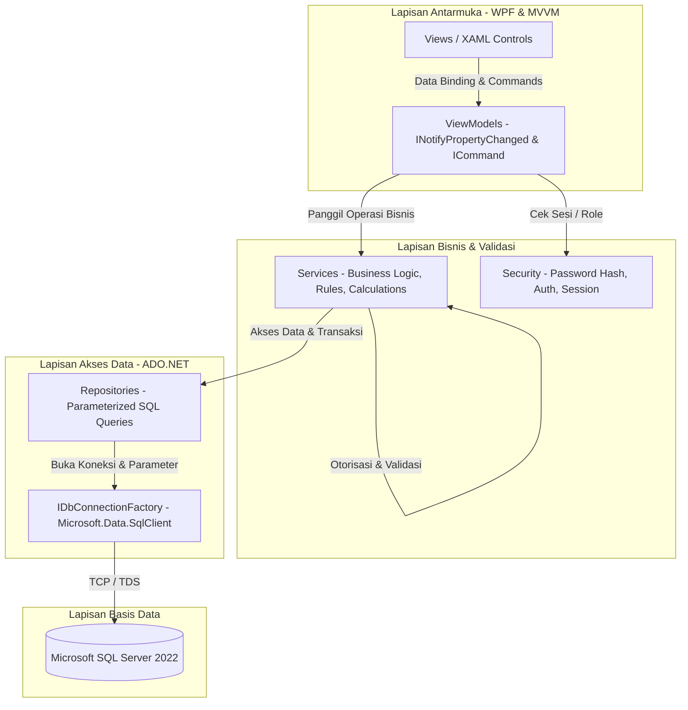

# Architecture Document (ARCHITECTURE.md)
## AgroTrack: Sistem Informasi Manajemen Produksi Pertanian Berbasis Desktop

Dokumen ini menjelaskan arsitektur perangkat lunak, struktur lapisan (layering), pola desain MVVM, manajemen koneksi data ADO.NET, dan mekanisme keamanan pada aplikasi **AgroTrack**.

---

## 1. Ikhtisar Arsitektur Berlapis (Layered Architecture)

Aplikasi AgroTrack dirancang dengan prinsip *Separation of Concerns* (SoC) yang ketat. Seluruh alur data dan kendali dibagi ke dalam 4 lapisan utama:



---

## 2. Tanggung Jawab Komponen

### 2.1 View & XAML
* Bertanggung jawab secara eksklusif atas visualisasi, layout antarmuka, binding ke ViewModel, styling, visual state, dan interaksi pengguna.
* **Aturan Kritis**: Tidak boleh membuka koneksi database (`SqlConnection`), tidak boleh mengeksekusi query SQL, dan tidak boleh menampung business logic di code-behind (`.xaml.cs`).

### 2.2 ViewModel
* Mengelola status UI (UI State) seperti `IsLoading`, `HasError`, `ErrorMessage`, `IsEmpty`, serta koleksi data (`ObservableCollection<T>`).
* Menyediakan properti binding dua arah (`INotifyPropertyChanged`) dan perintah aksi (`ICommand` melalui `RelayCommand` dan `AsyncRelayCommand`).
* Meneruskan aksi pengguna ke Service layer dan memperbarui state secara asynchronous (`async/await`) untuk menjaga responsivitas UI.

### 2.3 Service Layer
* Mengatur seluruh aturan bisnis:
  * Validasi kapasitas lahan (memastikan akumulasi penanaman aktif tidak melebihi luas fisik lahan).
  * Validasi batas persediaan bahan pertanian dan perhitungan snapshot harga saat pemakaian.
  * Otorisasi role: Memverifikasi apakah pengguna aktif berhak melakukan tindakan sebelum memutasi data.
  * Kalkulasi finansial: Total pendapatan panen, total biaya bahan, total biaya operasional, serta margin laba/rugi.
  * Orkestrasi transaksi: Membuka `SqlTransaction` saat transaksi melibatkan pembaruan stok bahan dan pencatatan riwayat pemakaian.

### 2.4 Repository Layer & ADO.NET
* Bertanggung jawab khusus untuk interaksi dengan SQL Server menggunakan `Microsoft.Data.SqlClient`.
* Menggunakan `IDbConnectionFactory` untuk mengelola pembuatan `SqlConnection`.
* **Wajib**: Menggunakan parameterized query (`SqlParameter`) untuk semua masukan pengguna guna mengeliminasi celah SQL Injection secara total.
* Menangani pemetaan dari `SqlDataReader` ke domain Model atau DTO.

---

## 3. Struktur Proyek & Namespace

```
AgroTrack.sln
├── src/
│   └── AgroTrack/
│       ├── AgroTrack.csproj
│       ├── App.xaml / App.xaml.cs          # Application Entry & Composition Root (DI)
│       ├── MainWindow.xaml / .cs           # Shell Window (Header, Sidebar, Content Host)
│       ├── Models/                         # Entitas Domain (User, Land, Commodity, Planting, ...)
│       ├── DTOs/                           # Data Transfer Objects (DashboardSummary, ProfitReport, ...)
│       ├── Enums/                          # Enum (UserRole, PlantingStatus, ActivityType, ...)
│       ├── Data/                           # Database Connection Factory & SQL Helpers
│       ├── Repositories/                   # Antarmuka dan Implementasi Akses Data ADO.NET
│       │   ├── Interfaces/
│       │   └── Implementations/
│       ├── Services/                       # Antarmuka dan Implementasi Logika Bisnis
│       │   ├── Interfaces/
│       │   └── Implementations/
│       ├── Security/                       # PasswordHasher (PBKDF2), SessionContext, CurrentUser
│       ├── ViewModels/                     # ViewModels untuk setiap halaman & dialog
│       ├── Views/                          # UserControl & Window XAML Views
│       │   ├── LoginView.xaml
│       │   ├── DashboardView.xaml
│       │   ├── LandView.xaml
│       │   ├── CommodityView.xaml
│       │   ├── PlantingView.xaml
│       │   ├── ActivityView.xaml
│       │   ├── MaterialView.xaml
│       │   ├── CostView.xaml
│       │   ├── HarvestView.xaml
│       │   ├── ReportView.xaml
│       │   ├── UserManagementView.xaml
│       │   └── Dialogs/
│       ├── Commands/                       # RelayCommand, AsyncRelayCommand
│       ├── Converters/                     # Value Converters XAML (BooleanToVisibility, Currency, Date, ...)
│       ├── Themes/                         # ResourceDictionary LightTheme.xaml & DarkTheme.xaml
│       ├── Resources/                      # ResourceDictionary Styles, Icons, Colors
│       └── Utilities/                      # PagedResult, Result<T>, DebounceDispatcher
└── tests/
    └── AgroTrack.Tests/
        ├── AgroTrack.Tests.csproj
        ├── CalculationTests.cs             # Uji unit perhitungan pendapatan, biaya, laba, % target
        ├── BusinessRuleTests.cs            # Uji unit validasi luas lahan, stok bahan, tanggal panen
        └── SecurityTests.cs                # Uji unit password hashing dan otorisasi role
```

---

## 4. Mekanisme Keamanan (Security)

1. **Password Hashing**: Menggunakan `Rfc2898DeriveBytes` (PBKDF2 dengan HMAC-SHA256, 100.000 iterasi, salt acak 16 byte, output hash 32 byte). Format penyimpanan: `{salt_base64}:{hash_base64}`.
2. **Pemberitahuan Otentikasi Aman**: Pesan kesalahan login seragam: *"Nama pengguna atau kata sandi tidak valid."* untuk mencegah *username enumeration*.
3. **Session Management**: `ISessionService` menyimpan data user yang sedang login (`UserId`, `Username`, `FullName`, `Role`). Saat logout, session dibersihkan secara instan.
4. **Proteksi Injeksi SQL**: Tidak ada perakitan string SQL (`string concatenation`). Semua nilai dinamis dimasukkan via `command.Parameters.Add(new SqlParameter(...))`.

---

## 5. Pola Navigasi & Tema Dinamis

* **Navigasi Single-Window**: Shell utama (`MainWindow.xaml`) menampung konten dinamis menggunakan binding ke `CurrentViewModel` pada `ContentControl`. Transisi tampilan tidak membuka window baru.
* **Manajemen Tema**: `ThemeService` mengelola pemuatan `ResourceDictionary` tema aktif (`LightTheme.xaml` atau `DarkTheme.xaml`) ke dalam `Application.Current.Resources.MergedDictionaries`. Pengguna dapat berganti tema kapan saja tanpa mematikan aplikasi.
