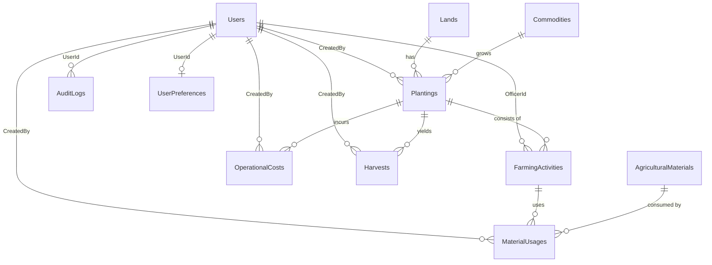

# Database Design Document (DATABASE_DESIGN.md)
## AgroTrack: Sistem Informasi Manajemen Produksi Pertanian Berbasis Desktop

Dokumen ini mendefinisikan rancangan fisik skema database SQL Server untuk aplikasi **AgroTrack**, relasi antar entitas, tipe data presisi, aturan kekangan (constraints), indeks, dan mekanisme transaksi.

---

## 1. Konvensi Penamaan
* **Nama Tabel**: Singular CamelCase / PascalCase (`Users`, `Lands`, `Commodities`, `Plantings`, `FarmingActivities`, `AgriculturalMaterials`, `MaterialUsages`, `OperationalCosts`, `Harvests`, `AuditLogs`, `UserPreferences`).
* **Primary Key**: `{EntityName}Id` (misal: `LandId`, `PlantingId`, `UserId`) bertipe `INT IDENTITY(1,1)`.
* **Foreign Key**: Menunjuk langsung ke nama Primary Key tabel rujukan (`LandId`, `CommodityId`, `CreatedBy`).
* **Format Waktu**: `DATETIME2` dengan default `SYSUTCDATETIME()`.
* **Format Mata Uang & Finansial**: `DECIMAL(18, 2)` untuk mencegah kesalahan pembulatan floating point.
* **Format Kuantitas / Area**: `DECIMAL(10, 2)` untuk luas hektare dan kuantitas hasil/bahan.

---

## 2. Struktur Tabel & Aturan Kolom

### 2.1 Users
Menyimpan kredensial dan hak akses pengguna sistem.
| Kolom | Tipe Data | Nullable | Keterangan & Constraint |
| :--- | :--- | :---: | :--- |
| `UserId` | `INT IDENTITY(1,1)` | Tidak | **PK** |
| `Username` | `NVARCHAR(50)` | Tidak | **UNIQUE**, Case-insensitive |
| `PasswordHash` | `NVARCHAR(256)` | Tidak | Format hash salted PBKDF2 |
| `FullName` | `NVARCHAR(100)` | Tidak | Nama lengkap pengguna |
| `Role` | `NVARCHAR(30)` | Tidak | CHECK (`Role IN ('Administrator', 'Manager', 'FieldOfficer')`) |
| `IsActive` | `BIT` | Tidak | DEFAULT 1 |
| `CreatedAt` | `DATETIME2` | Tidak | DEFAULT SYSUTCDATETIME() |
| `UpdatedAt` | `DATETIME2` | Ya | Waktu pembaruan terakhir |

### 2.2 Lands (Lahan)
Menyimpan master data lahan pertanian fisik.
| Kolom | Tipe Data | Nullable | Keterangan & Constraint |
| :--- | :--- | :---: | :--- |
| `LandId` | `INT IDENTITY(1,1)` | Tidak | **PK** |
| `LandCode` | `NVARCHAR(30)` | Tidak | **UNIQUE** (misal: `LHN-001`) |
| `LandName` | `NVARCHAR(100)` | Tidak | Nama lahan |
| `Location` | `NVARCHAR(200)` | Tidak | Lokasi geografis/alamat |
| `AreaHectares` | `DECIMAL(10,2)` | Tidak | CHECK (`AreaHectares > 0`) |
| `SoilType` | `NVARCHAR(50)` | Tidak | Aluvial, Lempung, Gambut, dll. |
| `Status` | `NVARCHAR(30)` | Tidak | CHECK (`Status IN ('Active', 'Resting', 'Maintenance', 'Inactive')`) |
| `Description` | `NVARCHAR(500)` | Ya | Catatan tambahan |
| `CreatedAt` | `DATETIME2` | Tidak | DEFAULT SYSUTCDATETIME() |
| `UpdatedAt` | `DATETIME2` | Ya | Waktu pembaruan terakhir |

### 2.3 Commodities (Komoditas)
Menyimpan jenis tanaman/hasil tani yang dibudidayakan.
| Kolom | Tipe Data | Nullable | Keterangan & Constraint |
| :--- | :--- | :---: | :--- |
| `CommodityId` | `INT IDENTITY(1,1)` | Tidak | **PK** |
| `CommodityCode` | `NVARCHAR(30)` | Tidak | **UNIQUE** (misal: `KMD-001`) |
| `CommodityName` | `NVARCHAR(100)` | Tidak | Padi, Jagung, Cabai, dll. |
| `ResultUnit` | `NVARCHAR(20)` | Tidak | kg, ton, kuintal, ikat, dll. |
| `EstimatedGrowthDays` | `INT` | Tidak | CHECK (`EstimatedGrowthDays >= 0`) |
| `Description` | `NVARCHAR(500)` | Ya | Deskripsi varietas/karakteristik |
| `IsActive` | `BIT` | Tidak | DEFAULT 1 |
| `CreatedAt` | `DATETIME2` | Tidak | DEFAULT SYSUTCDATETIME() |
| `UpdatedAt` | `DATETIME2` | Ya | Waktu pembaruan |

### 2.4 Plantings (Penanaman / Musim Tanam)
Entitas sentral siklus operasional pertanian.
| Kolom | Tipe Data | Nullable | Keterangan & Constraint |
| :--- | :--- | :---: | :--- |
| `PlantingId` | `INT IDENTITY(1,1)` | Tidak | **PK** |
| `PlantingCode` | `NVARCHAR(30)` | Tidak | **UNIQUE** (misal: `PLN-2026-001`) |
| `LandId` | `INT` | Tidak | **FK** -> `Lands(LandId)` |
| `CommodityId` | `INT` | Tidak | **FK** -> `Commodities(CommodityId)` |
| `SeasonName` | `NVARCHAR(100)` | Tidak | Musim Hujan 2026, Musim Kemarau I |
| `StartDate` | `DATE` | Tidak | Tanggal tanam dimulai |
| `ExpectedHarvestDate` | `DATE` | Tidak | CHECK (`ExpectedHarvestDate >= StartDate`) |
| `CompletionDate` | `DATE` | Ya | Tanggal selesai aktual |
| `PlantedAreaHectares` | `DECIMAL(10,2)` | Tidak | CHECK (`PlantedAreaHectares > 0`) |
| `TargetYield` | `DECIMAL(12,2)` | Tidak | CHECK (`TargetYield >= 0`) |
| `Status` | `NVARCHAR(30)` | Tidak | CHECK (`Status IN ('Planned', 'Active', 'ReadyToHarvest', 'Completed', 'Cancelled')`) |
| `Notes` | `NVARCHAR(1000)`| Ya | Catatan musim |
| `CreatedBy` | `INT` | Tidak | **FK** -> `Users(UserId)` |
| `CreatedAt` | `DATETIME2` | Tidak | DEFAULT SYSUTCDATETIME() |
| `UpdatedAt` | `DATETIME2` | Ya | Waktu pembaruan |

### 2.5 FarmingActivities (Aktivitas Lapangan)
Log aktivitas kegiatan harian para petani/petugas pada penanaman tertentu.
| Kolom | Tipe Data | Nullable | Keterangan & Constraint |
| :--- | :--- | :---: | :--- |
| `ActivityId` | `INT IDENTITY(1,1)` | Tidak | **PK** |
| `PlantingId` | `INT` | Tidak | **FK** -> `Plantings(PlantingId)` |
| `ActivityType` | `NVARCHAR(50)` | Tidak | Persiapan lahan, Penanaman, Pemupukan, dll. |
| `ActivityDate` | `DATE` | Tidak | Tanggal pelaksanaan |
| `Description` | `NVARCHAR(1000)`| Tidak | Deskripsi detil pekerjaan |
| `OfficerId` | `INT` | Tidak | **FK** -> `Users(UserId)` |
| `DurationHours` | `DECIMAL(5,2)` | Ya | CHECK (`DurationHours IS NULL OR DurationHours >= 0`) |
| `Status` | `NVARCHAR(30)` | Tidak | CHECK (`Status IN ('Scheduled', 'InProgress', 'Completed', 'Cancelled')`) |
| `CreatedAt` | `DATETIME2` | Tidak | DEFAULT SYSUTCDATETIME() |
| `UpdatedAt` | `DATETIME2` | Ya | Waktu pembaruan |

### 2.6 AgriculturalMaterials (Bahan Pertanian & Stok)
Inventaris pupuk, bibit/benih, pestisida, dan perkakas habis pakai.
| Kolom | Tipe Data | Nullable | Keterangan & Constraint |
| :--- | :--- | :---: | :--- |
| `MaterialId` | `INT IDENTITY(1,1)` | Tidak | **PK** |
| `MaterialCode` | `NVARCHAR(30)` | Tidak | **UNIQUE** (misal: `MAT-001`) |
| `MaterialName` | `NVARCHAR(100)` | Tidak | Nama bahan |
| `Category` | `NVARCHAR(50)` | Tidak | Benih, Pupuk, Pestisida, dll. |
| `Unit` | `NVARCHAR(20)` | Tidak | kg, liter, sak, botol, pack |
| `Stock` | `DECIMAL(10,2)` | Tidak | CHECK (`Stock >= 0`) |
| `MinimumStock` | `DECIMAL(10,2)` | Tidak | CHECK (`MinimumStock >= 0`) |
| `UnitPrice` | `DECIMAL(18,2)` | Tidak | CHECK (`UnitPrice >= 0`) |
| `IsActive` | `BIT` | Tidak | DEFAULT 1 |
| `CreatedAt` | `DATETIME2` | Tidak | DEFAULT SYSUTCDATETIME() |
| `UpdatedAt` | `DATETIME2` | Ya | Waktu pembaruan |

### 2.7 MaterialUsages (Penggunaan Bahan)
Pencatatan alokasi bahan tertentu ke dalam aktivitas pertanian.
| Kolom | Tipe Data | Nullable | Keterangan & Constraint |
| :--- | :--- | :---: | :--- |
| `MaterialUsageId` | `INT IDENTITY(1,1)` | Tidak | **PK** |
| `ActivityId` | `INT` | Tidak | **FK** -> `FarmingActivities(ActivityId)` |
| `MaterialId` | `INT` | Tidak | **FK** -> `AgriculturalMaterials(MaterialId)` |
| `Quantity` | `DECIMAL(10,2)` | Tidak | CHECK (`Quantity > 0`) |
| `PriceAtUsage` | `DECIMAL(18,2)` | Tidak | Harga satuan saat dipakai |
| `Subtotal` | `DECIMAL(18,2)` | Tidak | `Quantity * PriceAtUsage` |
| `CreatedAt` | `DATETIME2` | Tidak | DEFAULT SYSUTCDATETIME() |
| `CreatedBy` | `INT` | Tidak | **FK** -> `Users(UserId)` |

### 2.8 OperationalCosts (Biaya Operasional)
Pencatatan pos-pos pengeluaran di luar bahan baku untuk penanaman.
| Kolom | Tipe Data | Nullable | Keterangan & Constraint |
| :--- | :--- | :---: | :--- |
| `CostId` | `INT IDENTITY(1,1)` | Tidak | **PK** |
| `PlantingId` | `INT` | Tidak | **FK** -> `Plantings(PlantingId)` |
| `CostDate` | `DATE` | Tidak | Tanggal pengeluaran |
| `Category` | `NVARCHAR(50)` | Tidak | Tenaga kerja, Sewa alat, Transportasi, dll. |
| `Description` | `NVARCHAR(500)` | Tidak | Keterangan biaya |
| `Amount` | `DECIMAL(18,2)` | Tidak | CHECK (`Amount > 0`) |
| `CreatedBy` | `INT` | Tidak | **FK** -> `Users(UserId)` |
| `CreatedAt` | `DATETIME2` | Tidak | DEFAULT SYSUTCDATETIME() |
| `UpdatedAt` | `DATETIME2` | Ya | Waktu pembaruan |

### 2.9 Harvests (Hasil Panen)
Mencatat hasil panen riil dan penjualan dari penanaman (bisa berkali-kali).
| Kolom | Tipe Data | Nullable | Keterangan & Constraint |
| :--- | :--- | :---: | :--- |
| `HarvestId` | `INT IDENTITY(1,1)` | Tidak | **PK** |
| `PlantingId` | `INT` | Tidak | **FK** -> `Plantings(PlantingId)` |
| `HarvestDate` | `DATE` | Tidak | Tanggal panen |
| `YieldAmount` | `DECIMAL(12,2)` | Tidak | CHECK (`YieldAmount > 0`) |
| `Quality` | `NVARCHAR(30)` | Tidak | Grade A, Grade B, Grade C, Standar |
| `SellingPricePerUnit`| `DECIMAL(18,2)`| Tidak | CHECK (`SellingPricePerUnit >= 0`) |
| `TotalRevenue` | `DECIMAL(18,2)` | Tidak | `YieldAmount * SellingPricePerUnit` |
| `Notes` | `NVARCHAR(500)` | Ya | Keterangan kualitas/pembeli |
| `CreatedBy` | `INT` | Tidak | **FK** -> `Users(UserId)` |
| `CreatedAt` | `DATETIME2` | Tidak | DEFAULT SYSUTCDATETIME() |
| `UpdatedAt` | `DATETIME2` | Ya | Waktu pembaruan |

### 2.10 AuditLogs (Log Jejak Audit)
Mencatat aktivitas penting yang dilakukan pengguna.
| Kolom | Tipe Data | Nullable | Keterangan |
| :--- | :--- | :---: | :--- |
| `AuditLogId` | `BIGINT IDENTITY(1,1)` | Tidak | **PK** |
| `UserId` | `INT` | Ya | **FK** -> `Users(UserId)` (ON DELETE SET NULL) |
| `ActionType` | `NVARCHAR(50)` | Tidak | CREATE, UPDATE, DELETE, LOGIN, LOGOUT |
| `EntityName` | `NVARCHAR(50)` | Tidak | Lands, Plantings, Materials, dll. |
| `EntityId` | `NVARCHAR(50)` | Ya | ID entitas yang dimanipulasi |
| `Description` | `NVARCHAR(1000)`| Tidak | Rincian aktivitas (tanpa data rahasia) |
| `Timestamp` | `DATETIME2` | Tidak | DEFAULT SYSUTCDATETIME() |

### 2.11 UserPreferences (Preferensi Tampilan Pengguna)
| Kolom | Tipe Data | Nullable | Keterangan |
| :--- | :--- | :---: | :--- |
| `PreferenceId` | `INT IDENTITY(1,1)` | Tidak | **PK** |
| `UserId` | `INT` | Tidak | **FK** -> `Users(UserId)` (UNIQUE, 1-to-1) |
| `Theme` | `NVARCHAR(20)` | Tidak | CHECK (`Theme IN ('Light', 'Dark')`) DEFAULT 'Light' |
| `UpdatedAt` | `DATETIME2` | Tidak | DEFAULT SYSUTCDATETIME() |

---

## 3. Relasi & Integritas Referensial (Diagram Logis)

---

## 4. Indeks Kinerja Basis Data
Untuk mengoptimalkan waktu eksekusi query pencarian, filter, dan agregasi laporan:
1. `IX_Users_Username` ON `Users(Username)`
2. `IX_Lands_LandCode` ON `Lands(LandCode)`
3. `IX_Commodities_CommodityCode` ON `Commodities(CommodityCode)`
4. `IX_Plantings_Land_Status` ON `Plantings(LandId, Status)`
5. `IX_Plantings_Commodity_Status` ON `Plantings(CommodityId, Status)`
6. `IX_Plantings_StartDate_HarvestDate` ON `Plantings(StartDate, ExpectedHarvestDate)`
7. `IX_FarmingActivities_Planting_Date` ON `FarmingActivities(PlantingId, ActivityDate)`
8. `IX_OperationalCosts_Planting_Date` ON `OperationalCosts(PlantingId, CostDate)`
9. `IX_Harvests_Planting_Date` ON `Harvests(PlantingId, HarvestDate)`
10. `IX_MaterialUsages_Activity` ON `MaterialUsages(ActivityId)`
11. `IX_AgriculturalMaterials_Code` ON `AgriculturalMaterials(MaterialCode)`
12. `IX_AuditLogs_Timestamp` ON `AuditLogs(Timestamp DESC)`
