# Implementation Plan (IMPLEMENTATION_PLAN.md)
## AgroTrack: Sistem Informasi Manajemen Produksi Pertanian Berbasis Desktop

Rencana kerja implementasi bertahap dari Fase 0 hingga Fase 11 sesuai panduan master prompt.

---

## Ringkasan Fase

```mermaid
graph LR
    P0[Fase 0: Perencanaan] --> P1[Fase 1: Fondasi Proyek]
    P1 --> P2[Fase 2: Basis Data]
    P2 --> P3[Fase 3: Autentikasi & Shell]
    P3 --> P4[Fase 4: Master Data]
    P4 --> P5[Fase 5: Penanaman]
    P5 --> P6[Fase 6: Aktivitas Lapangan]
    P6 --> P7[Fase 7: Biaya & Panen]
    P7 --> P8[Fase 8: Dashboard & Laporan]
    P8 --> P9[Fase 9: Bahan & Stok]
    P9 --> P10[Fase 10: Polish UI]
    P10 --> P11[Fase 11: QA & Audit]
```

---

## Rincian Tiap Fase

### Fase 0: Inspeksi & Perencanaan
- [x] Periksa workspace dan direktori.
- [x] Periksa ketersediaan Git dan inisialisasi repository.
- [x] Periksa .NET SDK (`dotnet --list-sdks`).
- [x] Uji kompilasi cross-platform WPF dengan `<EnableWindowsTargeting>true</EnableWindowsTargeting>`.
- [x] Periksa ketersediaan SQL Server dan container engine (Podman rootless).
- [x] Buat dokumen `PRD_AGROTRACK.md`.
- [x] Buat dokumen `DECISIONS.md`.
- [x] Buat dokumen `DATABASE_DESIGN.md`.
- [x] Buat dokumen `ARCHITECTURE.md`.
- [x] Buat dokumen `IMPLEMENTATION_PLAN.md`.
- [x] Buat dokumen `TEST_PLAN_AND_RESULTS.md`.
- [x] Buat dokumen `PROGRESS.md`.

### Fase 1: Fondasi Proyek
- [ ] Buat Solution `AgroTrack.sln`.
- [ ] Buat proyek WPF `src/AgroTrack/AgroTrack.csproj` targeting `net8.0-windows`.
- [ ] Tambahkan package `Microsoft.Data.SqlClient`, `Microsoft.Extensions.DependencyInjection`, `Microsoft.Extensions.Configuration.Json`.
- [ ] Buat proyek pengujian `tests/AgroTrack.Tests/AgroTrack.Tests.csproj` targeting `net8.0`.
- [ ] Buat struktur direktori (Models, ViewModels, Views, Repositories, Services, dll).
- [ ] Buat `ViewModelBase`, `RelayCommand`, `AsyncRelayCommand`.
- [ ] Buat abstraksi Navigation, Session, Theme, dan Notification dialog.
- [ ] Buat `appsettings.json` dan helper konfigurasi.
- [ ] Eksekusi `dotnet build` & pastikan lolos Quality Gate.

### Fase 2: Database & Akses Data
- [ ] Buat `database/001_CreateDatabase.sql`.
- [ ] Buat `database/002_CreateTables.sql`.
- [ ] Buat `database/003_CreateIndexes.sql`.
- [ ] Buat `database/004_SeedData.sql` (kredensial hash, data realistis).
- [ ] Buat `database/005_VerificationQueries.sql`.
- [ ] Buat `database/ResetDevelopmentDatabase.sql`.
- [ ] Buat `DbConnectionFactory` dan antarmuka `IDbConnectionFactory`.
- [ ] Setup container SQL Server lokal dan jalankan migrasi database.
- [ ] Verifikasi konektivitas dan perbarui dokumen progress.

### Fase 3: Autentikasi dan Shell Aplikasi
- [ ] Implementasikan `IPasswordHasher` dengan PBKDF2 (salt 16-byte, 100k iterasi).
- [ ] Buat `UserRepository` dan `AuthenticationService`.
- [ ] Buat `LoginViewModel` dan `LoginView.xaml` (UI profesional, input validation, loading indicator).
- [ ] Buat `MainWindowViewModel` dan `MainWindow.xaml` (Header, Sidebar navigasi, breadcrumb, status role).
- [ ] Buat `ThemeService` untuk switching Light/Dark mode.
- [ ] Uji alur login (sukses, gagal, akun nonaktif) dan logout.
- [ ] Jalankan build dan perbarui progress.

### Fase 4: Master Data Lahan & Komoditas
- [ ] Implementasikan `Land` model, repository, service, view model, dan view.
- [ ] Implementasikan `Commodity` model, repository, service, view model, dan view.
- [ ] Sediakan DataGrid, dialog form tambah/ubah, konfirmasi hapus, pencarian, filter, dan pagination.
- [ ] Sediakan visual feedback: Loading state, Empty state, Error state.
- [ ] Jalankan build dan perbarui progress.

### Fase 5: Manajemen Penanaman (Planting)
- [ ] Implementasikan `Planting` model, DTO, repository, service, view model, dan view.
- [ ] Validasi aturan bisnis: kapasitas lahan vs luas tanam, irisan rentang waktu musim tanam aktif, tanggal target panen.
- [ ] Sediakan UI daftar musim tanam, filter status (Direncanakan, Aktif, Siap Panen, Selesai, Dibatalkan), dan detail penanaman.
- [ ] Jalankan build dan perbarui progress.

### Fase 6: Aktivitas Lapangan (Farming Activities)
- [ ] Implementasikan `FarmingActivity` model, repository, service, view model, dan view.
- [ ] Filter berdasar penanaman, tanggal, jenis aktivitas, dan petugas.
- [ ] Validasi status penanaman: tidak dapat menambah aktivitas pada penanaman yang sudah selesai/dibatalkan.
- [ ] Pembatasan hak akses Petugas Lapangan.
- [ ] Jalankan build dan perbarui progress.

### Fase 7: Biaya Operasional dan Hasil Panen
- [ ] Implementasikan `OperationalCost` model, repository, service, view model, dan view.
- [ ] Implementasikan `Harvest` model, repository, service, view model, dan view.
- [ ] Kalkulasi otomatis: Total Pendapatan (`Yield * Price`), Akumulasi Biaya, Keuntungan Bersih, dan Persentase Capaian Target.
- [ ] Format mata uang Rupiah (`Rp #,##0.00`) yang konsisten.
- [ ] Jalankan build dan perbarui progress.

### Fase 8: Dashboard & Laporan Produksi
- [ ] Implementasikan `DashboardRepository` untuk query agregasi database SQL Server.
- [ ] Buat kartu statistik real-time (Lahan, Luas, Penanaman Aktif, Biaya, Pendapatan, Laba).
- [ ] Buat visualisasi perbandingan target vs aktual dan tren panen berbasis komponen visual WPF.
- [ ] Buat modul `ReportView` untuk melihat rekapitulasi laba-rugi dan produksi per penanaman.
- [ ] Pastikan seluruh angka berasal dari database (tidak ada angka statis).
- [ ] Verifikasi seluruh fitur MUST.

### Fase 9: Bahan & Persediaan (Fitur Should)
- [ ] Implementasikan `AgriculturalMaterial` model, repository, service, view model, dan view.
- [ ] Implementasikan `MaterialUsage` dengan snapshot harga saat pemakaian.
- [ ] Implementasikan transaksi database atomik: pemakaian bahan otomatis memotong stok; pembatalan mengembalikan stok.
- [ ] Peringatan indikator stok minimum.
- [ ] Jalankan build dan perbarui progress.

### Fase 10: Polish UI & Design System
- [ ] Harmonisasi tema Terang & Gelap (kontras teks, warna status, icon).
- [ ] Review keyboard navigation, fokus form, dan dialog konfirmasi.
- [ ] Periksa konsistensi spasi, margin, dan batas minimum ukuran window.
- [ ] Jalankan build dan perbarui progress.

### Fase 11: QA, Unit Testing & Final Audit
- [ ] Tulis unit tests komprehensif pada `AgroTrack.Tests` (kalkulasi uang, pembagian nol, validasi luas tanam, validasi stok, hashing, otorisasi).
- [ ] Jalankan `dotnet test` dan pastikan 100% lulus.
- [ ] Jalankan build Debug dan Release (`dotnet build -c Release`).
- [ ] Audit menyeluruh terhadap larangan: tidak ada TODO/NotImplementedException, tidak ada query di View/ViewModel, tidak ada plain text password.
- [ ] Lengkapi dokumen: `USER_GUIDE.md`, `INSTALLATION_GUIDE.md`, `FINAL_AUDIT.md`, dan `README.md`.
